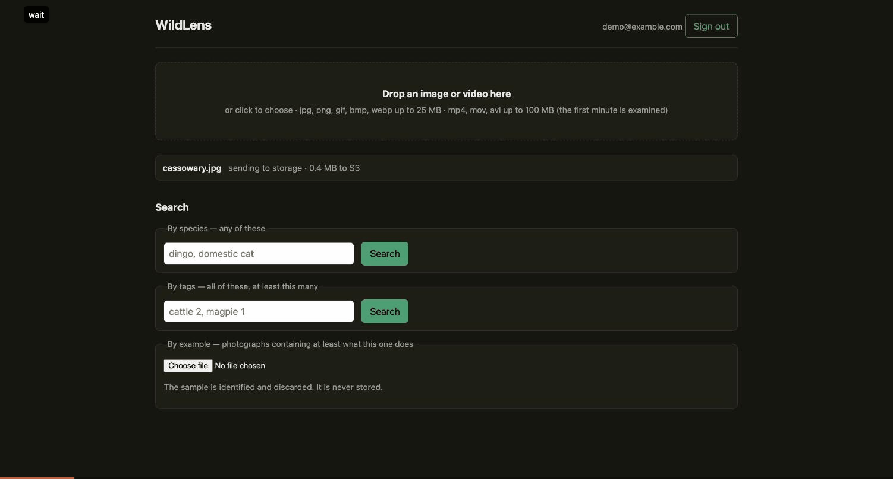

# WildLens

Serverless wildlife-tagging platform on AWS. Camera-trap images and video are
uploaded from the browser, tagged with species and counts by a two-stage ML
pipeline (MegaDetector, then a species classifier), and made searchable through
a Cognito-protected REST API. All infrastructure is Terraform.

**[▶ Try it live](https://d1y0xvoewbydft.cloudfront.net)** — choose **Sign in**,
then **Sign up** with any email address, confirm the code you are sent, and drop
a camera-trap photo or a short clip onto the page. It runs on a small AWS budget,
so it may be offline at times; the recording below shows what it does. Sign-up
codes go out through Cognito's built-in email sender, which allows about 50 a
day, so on a busy day the code may not arrive until the next one.

**[▶ Interactive architecture walkthrough](https://mingjun6886.github.io/wildlens/diagrams/pipeline.html)**
— step through all thirteen stages of the ingest path, the queue semantics, and
the cost guardrails.



## What makes this more than a demo

- **Infrastructure as code.** Every resource is in Terraform, thirteen modules
  composed in one environment. `terraform destroy` removes the whole estate
  between sessions, and every script reads names from Terraform output, so
  nothing breaks when the random suffixes change.
- **Cost-bounded ingest.** S3 events land in SQS instead of invoking Lambda
  directly, and the queue's event source mapping caps the tagger at two
  concurrent executions, with a dead-letter queue after three attempts. A
  runaway upload burst costs a few dollars instead of about $80 (ADR 1).
- **Measured, not asserted.** Cold-start latency is benchmarked before and after
  each optimisation, video timings are recorded from the first deployment, and
  model accuracy is scored against a hand-checked answer key by
  `ml/eval/run_eval.py`.
- **Operable.** Structured JSON logs with a correlation ID, EMF metrics, X-Ray
  subsegments around model loading, tagging and the thumbnail, a CloudWatch dashboard, five
  kinds of alarm (dead-letter queue not empty, errors per function, API 5xx,
  repeated transient failures, a file waiting too long in the queue) mailed to a
  separate alerts topic, and a [runbook](docs/runbook.md) organised by symptom.
- **Least privilege.** One IAM role per function (ADR 7). Uploads are checked
  against the hash they were stored under, so a client cannot store one file
  under another file's name (ADR 6).
- **No long-lived secrets in CI.** GitHub Actions lints, tests, builds the web
  client, validates Terraform and runs checkov without credentials. Pull
  requests that touch `infra/` get a `terraform plan` through a read-only OIDC
  role; CI never applies (ADR 10).

## Features

- **Upload images and video** from the browser, straight to S3 through a
  presigned URL: jpg, png, gif, bmp and webp up to 25 MB; mp4, mov and avi up to
  100 MB. The browser hashes the file first, so a file already in the collection
  is recognised without being sent again.
- **Tags with counts**, such as `{"southern cassowary": 1}`. A video is sampled
  at one frame per second for its first minute, and each species gets the
  largest count seen in any single frame (MaxN), so one animal standing still is
  counted once.
- **Search** by species (any of these), by tags with minimum counts (all of
  these, at least this many), or by example: upload a photograph and get back the
  files that contain at least what it does. The example is identified and
  discarded, never stored.
- **Email subscriptions** per species, through SNS filter policies (ADR 11).

## Measured results

Latency, tagging `Sus_scrofa_1.JPG` on a 3008 MB container Lambda in
`ap-southeast-2`. The optimisation is a single change: the module cache holds the
loaded MegaDetector rather than a path to its weights.

| | Before | After | Change |
|---|---|---|---|
| First invocation after deploy | 55.2 s | **42.3 s** | −23% |
| Cold start, p50 | 23.6 s | **21.5 s** | −9% |
| Warm | 8.35 s | **6.40 s** | −23% |
| Peak memory | 3000 MB | **2861 MB** | −139 MB |

Cold improved far less than predicted, for a reason worth stating: a cache cannot
help the invocation that populates it. The change moved a per-request cost to a
per-environment one, which is why warm gained and cold barely did. Re-measuring
also exposed a mis-read log line in the baseline report that had over-estimated
the expected cold-start saving tenfold. That is recorded in
[`docs/benchmarks/`](docs/benchmarks/) rather than quietly fixed.

Accuracy, scored per individual against a 26-image hand-checked answer key:

| Precision | Recall | F1 | TP | FP | FN |
|---|---|---|---|---|---|
| 0.821 | 1.000 | 0.901 | 32 | 7 | 0 |

Recall is 1.000: nothing in the key was missed. The seven false positives are
over-counts, and two close-range cattle frames account for five of them, frames
where the answer key itself carries real uncertainty, documented in
`ml/eval/answer_key.yaml`.

Video, from the first deployment (ADR 13), one 18 s 960x540 clip in three
containers plus shorter cuts:

| Clip | Start | Frames | Processing | Per frame |
|---|---|---|---|---|
| 18 s `.avi` | cold | 19 | 222 s | 8.7 s |
| 18 s `.mp4` | cold | 19 | 176 s | 6.2 s |
| 18 s `.mov` | cold | 19 | 137 s | 6.5 s |
| 10 s `.mp4` | cold | 11 | 108 s | 8.9 s |
| 5 s `.mp4` | warm | 6 | 54 s | 8.9 s |

A full 60-frame video therefore takes about 6 to 9 minutes, inside the 900 s
timeout with a 60 s guard that keeps the frames tagged so far.

## Known limitations

- **The species model knows 46 classes, mostly Australian.** It always picks its
  best class, with no confidence floor, so an animal it does not know gets the
  nearest label it does. North American deer in the video test were labelled
  dingo, fallow deer, cattle and birds from frame to frame.
- **Memory is near the ceiling.** The function has 3008 MB, the cap AWS sets on
  a new account. The cold-start benchmark above peaked at 2861 MB, but other
  image runs reached 2999 MB and a video 2911 MB. The design calls for 4096 MB
  once the account limit is raised.
- **Search scans the table** and filters in memory (ADR 4). Fine at this size;
  it would need an index long before it needed anything else.
- **Search by example is images only**, and must finish inside API Gateway's
  29 s limit. Warm and ordinary cold starts fit; the first call after a deploy
  (about 42 s) does not, and gets a 503 asking for a retry (ADR 5).

## Architecture

| Layer | Services |
|---|---|
| Client | Vite app, no framework, on S3 behind CloudFront |
| Auth | Cognito user pool, Hosted UI with PKCE, authoriser on every route |
| API | API Gateway REST, four Python 3.11 Lambdas sharing one artefact |
| Ingest | S3 → SQS (+ DLQ) → container Lambda, 3008 MB / 900 s, at most 2 at once |
| Data | DynamoDB on demand; abandoned uploads and failed records expire, tagged ones and their objects are kept (ADR 8) |
| Notify | SNS: a tags topic with per-subscriber filter policies, and an alerts topic |
| Observe | CloudWatch logs, EMF metrics, dashboard and alarms; X-Ray |

- Design document: [`docs/design/`](docs/design/), covering goals, the data
  model, the API contract, the ML pipeline, error handling, observability, cost
  controls and the build plan.
- Decisions: [`docs/adr/`](docs/adr/), thirteen records written when each
  decision was taken. Three record a decision that a measurement reversed or
  corrected, kept rather than tidied away.
- Operations: [`docs/runbook.md`](docs/runbook.md).
- Latency measurements: [`docs/benchmarks/`](docs/benchmarks/).

## Running it yourself

You need an AWS account, Terraform, Docker, Python 3.11 and Node. The model
weights are not in this repository: MegaDetector v5a is public, and the species
classifier is your own 46-class model with `ml/labels.txt`.

```bash
python3.11 -m venv .venv && source .venv/bin/activate
pip install -r requirements-dev.txt
pip install pillow==12.3.0 numpy==2.4.6 opencv-python-headless==5.0.0.93
pip install torch==2.14.0 torchvision==0.29.0 --index-url https://download.pytorch.org/whl/cpu
git config core.hooksPath .githooks
make check                       # lint and unit tests; no AWS needed
```

To deploy, first point the environment at your account: set `account_id` and
`state_bucket` in `infra/terraform/envs/dev/variables.tf` and the bucket in
`backend.tf`, and create that state bucket by hand. Then:

```bash
export AWS_PROFILE=<your profile>
aws ssm put-parameter --name /wildlens/dev/alert-email --type String --value "<address>"

terraform -chdir=infra/terraform/envs/dev init
terraform -chdir=infra/terraform/envs/dev apply -target=module.registry
./scripts/build-and-push.sh      # the function needs its image before it can exist
terraform -chdir=infra/terraform/envs/dev apply

MODELS=$(terraform -chdir=infra/terraform/envs/dev output -raw models_bucket_name)
aws s3 cp mdv5a.pt   "s3://$MODELS/v1/mdv5a.pt"
aws s3 cp model.pt   "s3://$MODELS/v1/model.pt"
aws s3 cp ml/labels.txt "s3://$MODELS/v1/labels.txt"

./scripts/write-web-env.sh && (cd web && npm ci) && ./scripts/deploy-web.sh
terraform -chdir=infra/terraform/envs/dev output -raw site_url
```

`terraform destroy` removes everything except the state bucket and the SSM
parameters. The runbook covers what to do when a step goes wrong.

## Repository layout

```
infra/terraform/   one environment (envs/dev) composing thirteen modules
services/process/  the tagging container: images, video, metrics, tracing
services/api/      upload, status, search and subscribe Lambdas
ml/                the two-stage tagger and its accuracy evaluation
web/               the browser client
scripts/           build, deploy and token helpers, all reading Terraform output
docs/              design, ADRs, runbook, benchmarks, diagram, demo recording
```

## Status

Phases 0 to 10, 12 and 13 are done: infrastructure, the tagger, the API, the web
client, notifications, observability, CI, video and this documentation. Phase 11,
verifying the Cognito token from a service on a second cloud, is optional and was
not built.

> Built solo as a portfolio project. The problem domain originates from a
> four-person university group assignment (FIT5225, Monash University); this is
> an independent rebuild with a different architecture, infrastructure-as-code,
> CI/CD, and model-accuracy evaluation.

## License

[MIT](LICENSE). The model weights are not part of this repository and carry
their own licences.
